# Commodore Keyboard Mapping Utilities

| Model  | keymaps          | Editor      | Driver  | KERNAL patcher | scankeys |
|--------|------------------|-------------|---------|----------------|----------|
| VIC-20 | ✅               | remap lite | ✅      |                | ✅       |
| C64    | ✅               | ✅         | ✅     | ✅             | ✅       |
| C128   | ✅               |            | ✅      |                |          |
| C16    | ✅               |            |         |                |          |
| Plus/4 | ✅               |            |         |                |          |

* keymaps = animated display of scancodes, plus scancode reference chart
* editor = select mapping of keys to individual PETSCII characters
* driver = key remap driver with tables (6 tables for C128, 4 tables for other) with sample remapping (punctuation)
* KERNAL patcher = patch ROM keyboard tables directly: in RAM temporarily (C64 only), and patch file to make permanent
* scankeys = utility to show scancode(s) activity by row/column when keys pressed

The keyboard maps for unshifted, SHIFT, Commodore, and Control are animated on screen drawing the PETSCII character in scan code order.  Commodore 128 adds Alt and Caps Lock maps, and different results will occur if DIN is pressed on international models.  International ROMs are available at [zimmers.net](https://zimmers.net/anonftp/pub/cbm/firmware/).

The BASIC versions are animated because they take a long time to draw, and purposefully draw in scancode (0..63) order, around 30 seconds processing and drawing time.  The machine language port (64) takes less than a second to do the same thing, so while it is doing the same animation, it is so fast you can't see it.

While the C64 has a full-blown editor included, remap keyboard drivers (without editors) are also available for C64, C128, and Vic-20.   Vic-20 includes a mini mapper.

Also see blog entries:\
[1. references](https://techwithdave.davevw.com/2026/10/commodore-programmers-keyboard.html)\
[2. Keyboard Editor/Driver for Commodore 64](https://techwithdave.davevw.com/2025/06/keyboard-editordriver-for-commodore-64.html)

## Commodore 64 

(Editor)
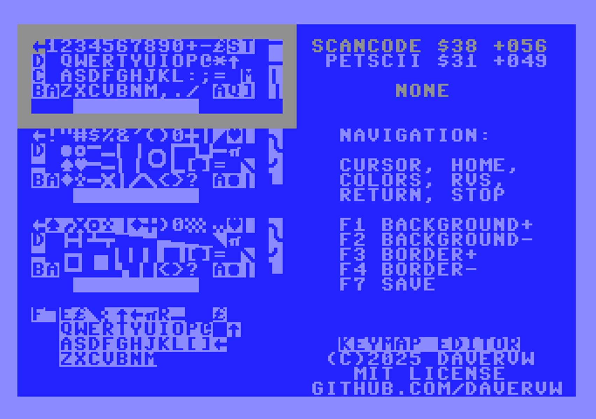

Editor/Driver instructions:

    F1-F4 change colors
    Control 1-8 and Commodore 1-8 change colors (WARNING: loses any changes in current build)
    Cursor keys and Home navigate
    Return opens character chooser window.  Navigate and select with ENTER, or if driver active, can test applied settings.
    Stop exits without saving (no WARNING)
    F7 saves to a driver that can be saved or RUN to apply changes.
    
WARNING: Save will wipe out any other program loaded at $0801.  Please also ````RUN```` to move next BASIC program to $0A01 otherwise could crash if driver is running and load another program over it.


(US)
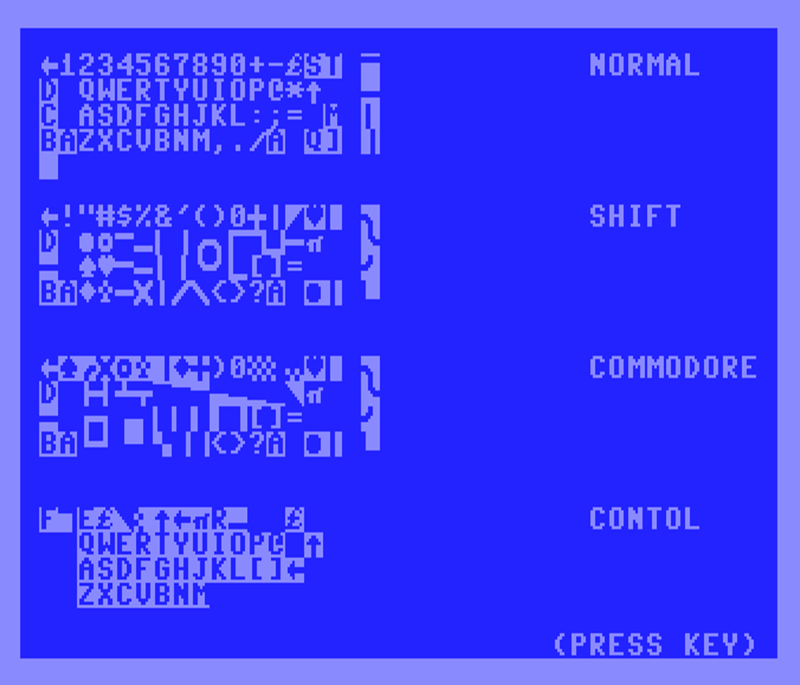

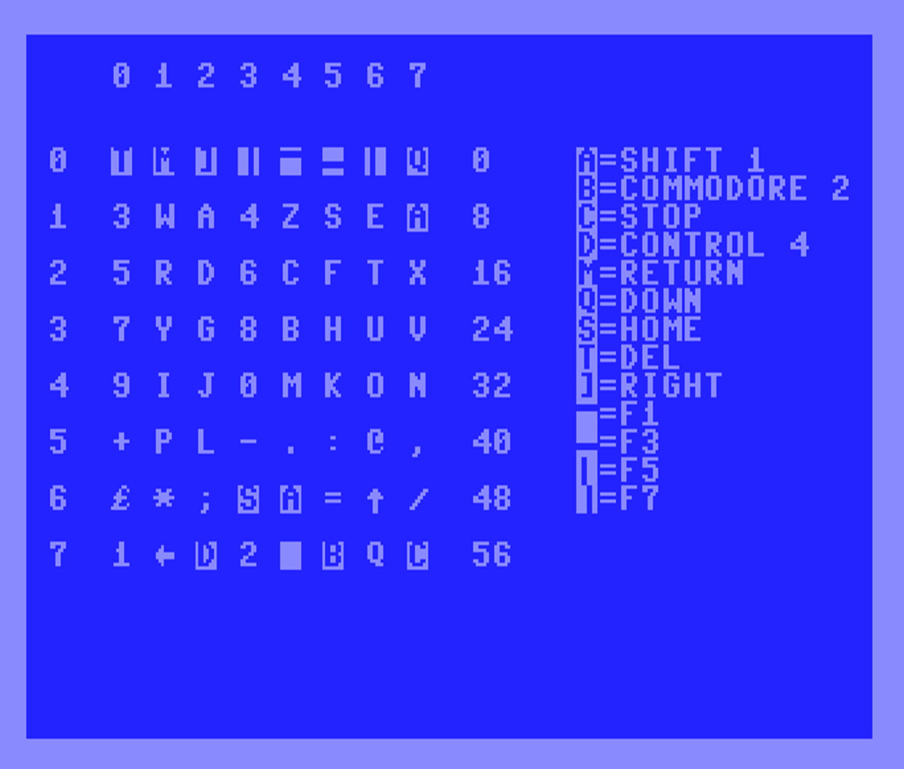

(Danish)
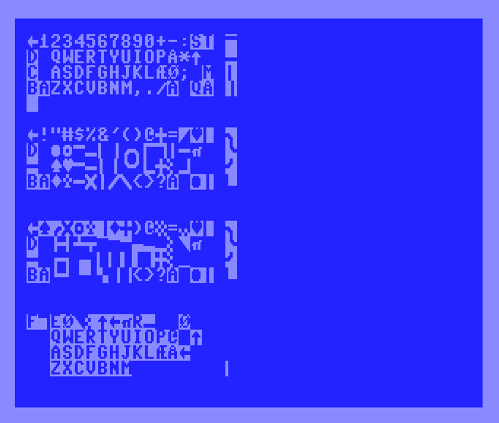

(Japan)
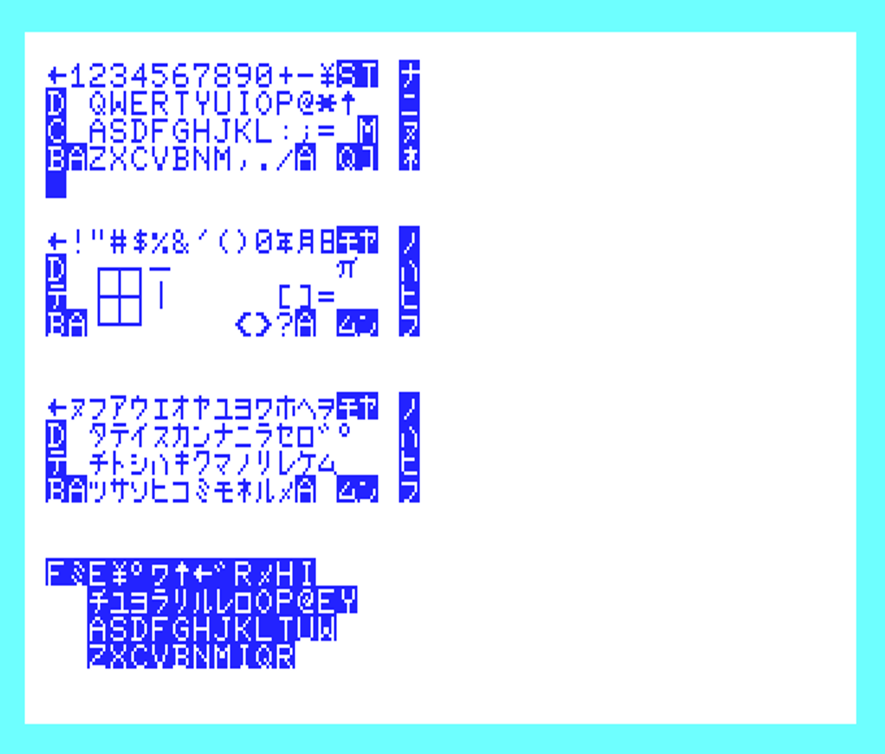

(Turkish)
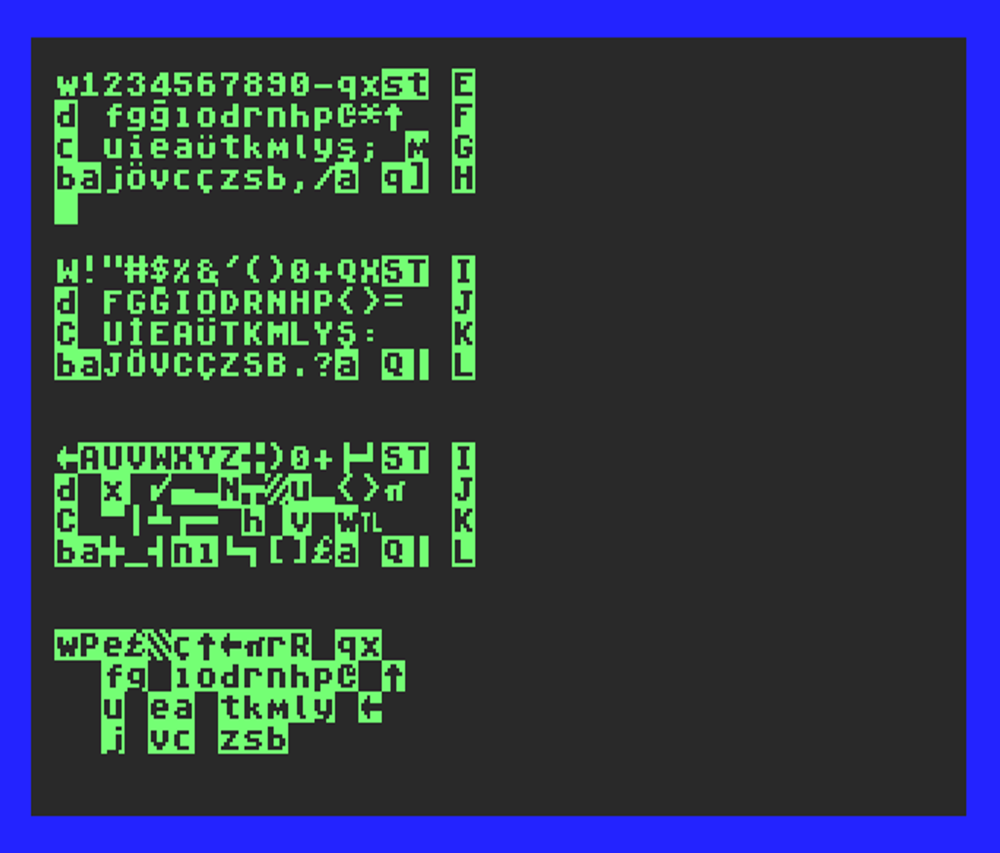

## Commodore Vic-20

(US)
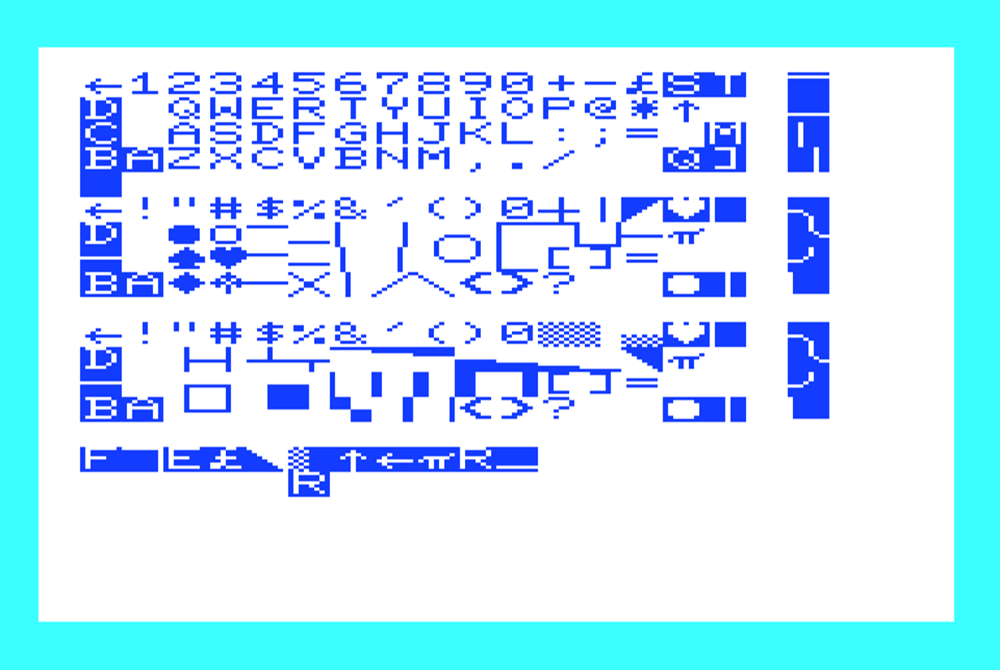

(Swedish/Finnish)
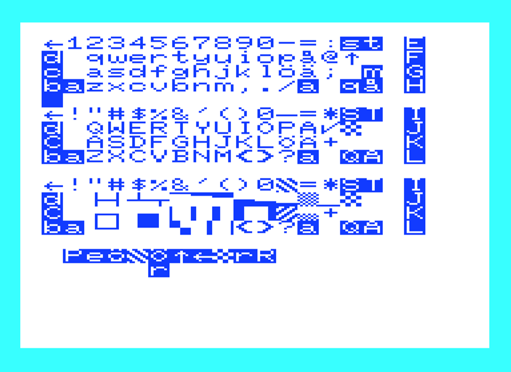

(Japan)
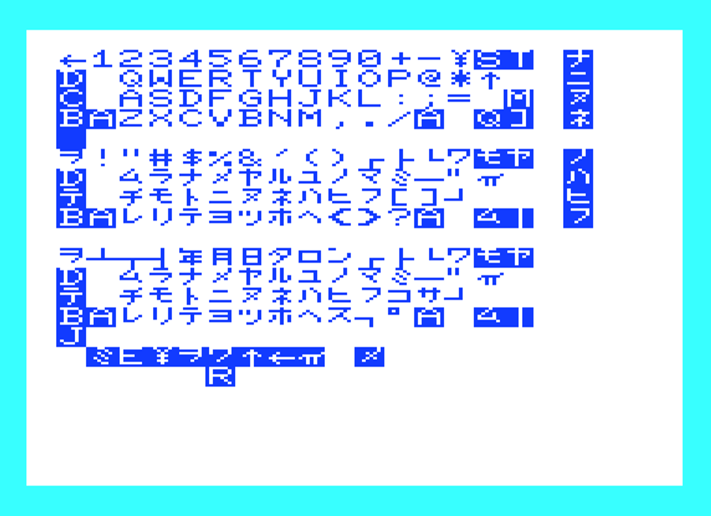

## Commodore 128

(US)
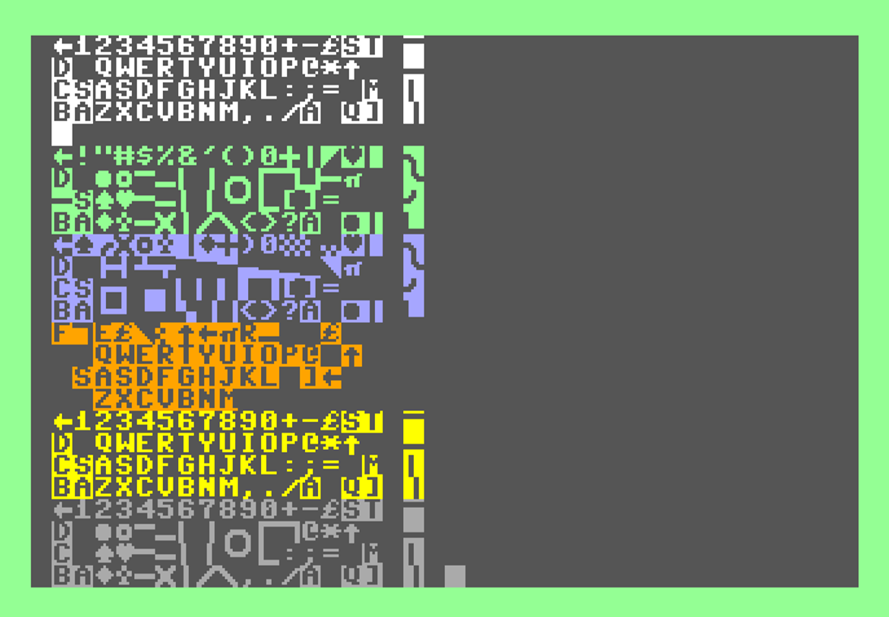

(French)
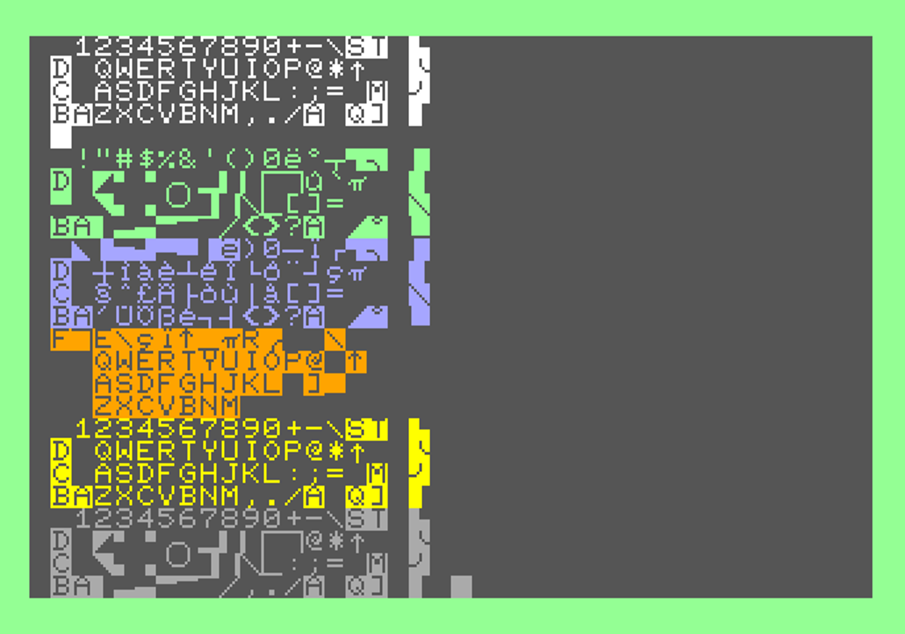

## Commodore Plus/4

(US)
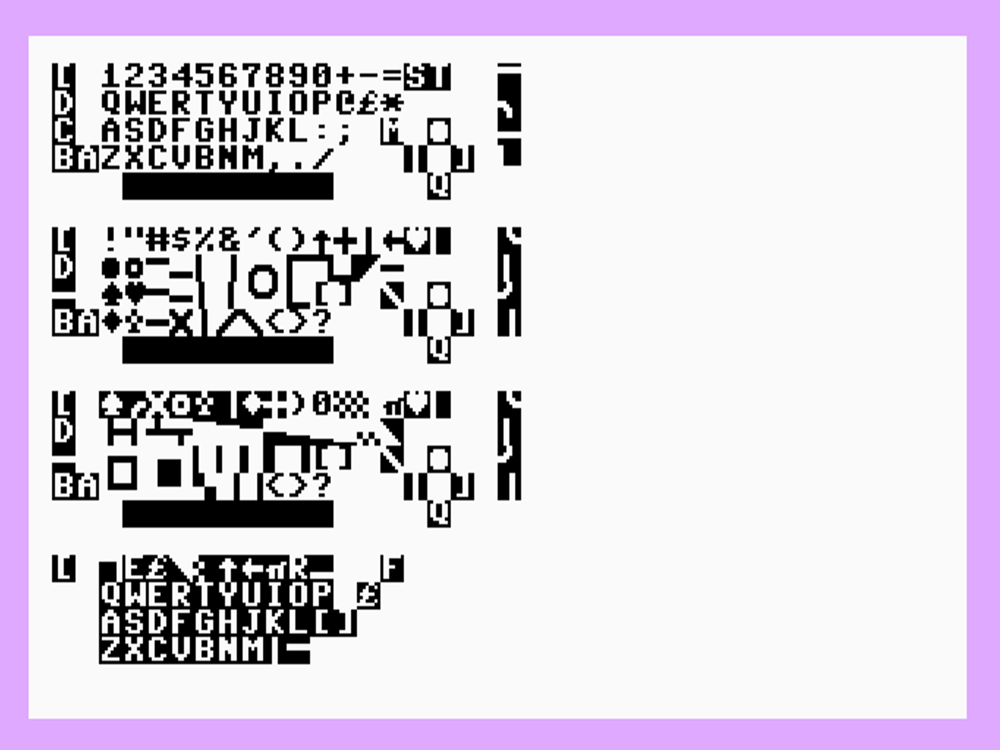

## Commodore 16

(US)
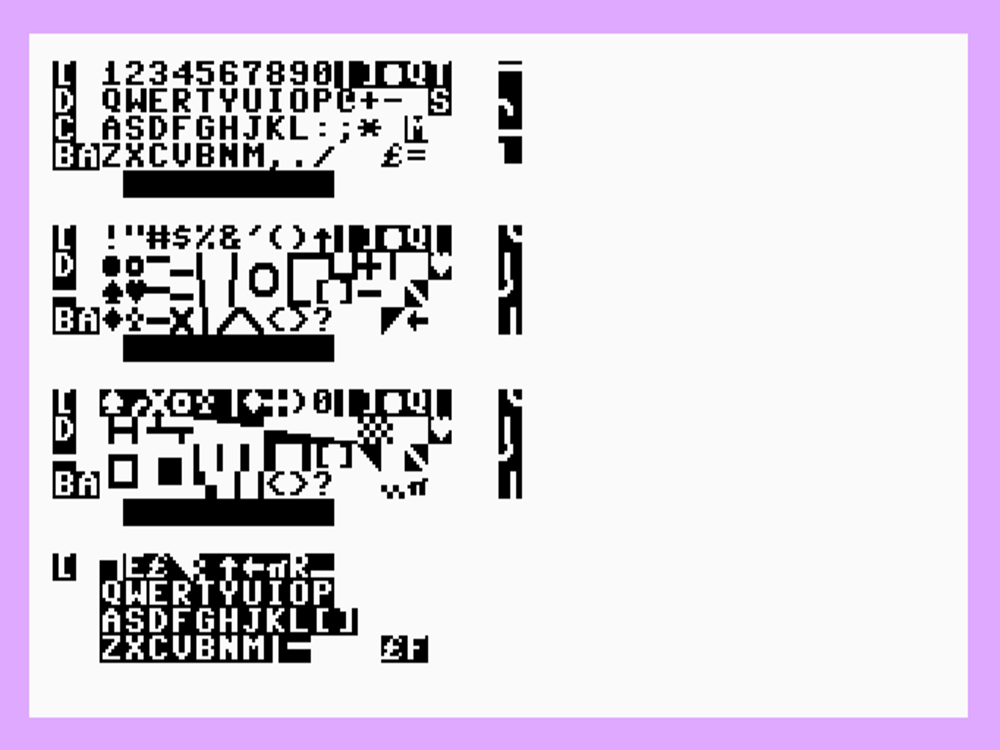
